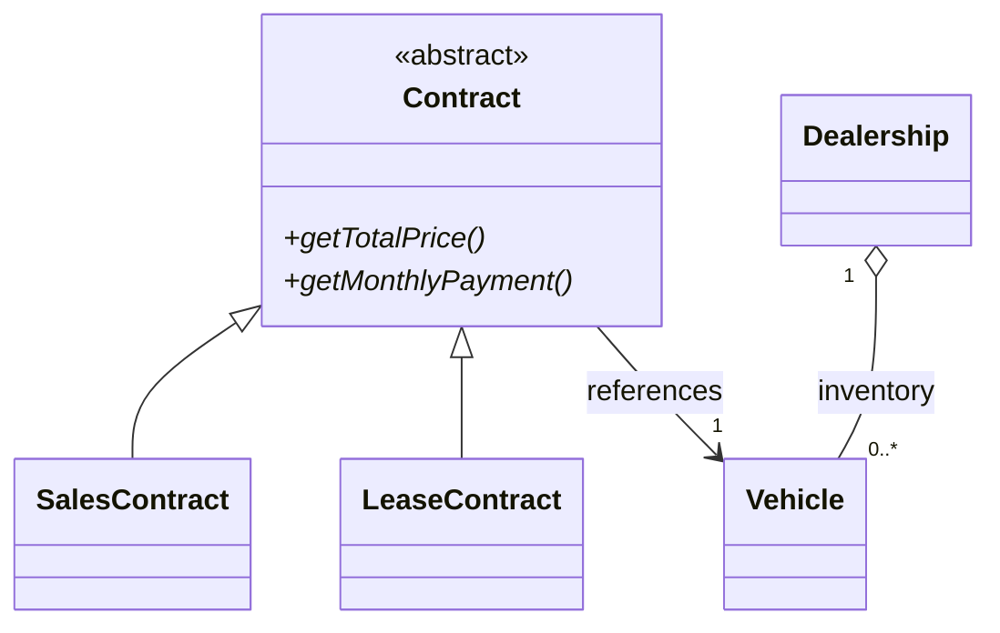

# 🚙 Car Dealership System · Part 2

> 🅿️ **Find a car** → 📝 **Sell or lease it** → 📁 **Save the contract**

A Java console app that lets you search a dealership’s inventory and record a vehicle sale or lease. Built for the Year Up United Object-Oriented Car Dealership workshop.

## 🔑 Take it for a test drive

1. **Start the app.** Open the project in IntelliJ IDEA, select the project’s JDK, and run `main()` in `Main.java`.
2. **Browse the lot.** Choose **List all vehicles** or search by price, make and model, year, color, mileage, or vehicle type.
3. **Pick a vehicle.** Choose **Sell/Lease a Vehicle**, enter its VIN and the customer details, then select a cash sale, financed sale, or lease.
4. **Check the result.** The app adds the contract to the shared contracts file. After the contract is saved, it removes the vehicle and saves the updated inventory.

> 📍 **Empty lot?** Check that `inventory.csv` is where `DealershipFileManager` expects it. If it uses a relative path, check the working directory in your IntelliJ run configuration.

## 🧩 How the classes fit together

| Class | Its job |
| --- | --- |
| `Main` and `UserInterface` | Start the app, show the menu, and guide the user through searches and transactions. |
| `Dealership` and `Vehicle` | Manage the lot and store each vehicle’s details. |
| `Contract` | Holds the customer’s name and email, contract date, and selected vehicle. |
| `SalesContract` and `LeaseContract` | Calculate totals and monthly payments using their own pricing rules. |
| `DealershipFileManager` | Reads and saves inventory. |
| `ContractDataManager` | Appends a pipe-delimited `SALE` or `LEASE` record to the shared contracts file. |

**Inheritance and polymorphism.** Every sale or lease is a type of `Contract`. The parent class is abstract because each transaction needs a specific set of pricing rules. Both subclasses override `getTotalPrice()` and `getMonthlyPayment()`. Calling `getMonthlyPayment()` on a `Contract` reference runs the calculation for the actual contract type.

**Aggregation.** A dealership holds vehicles in its inventory. A vehicle can leave the lot and still be referenced by its contract.

## 💰 Pricing at a glance

| Rule | 🛒 Sale | 🗝️ Lease |
| --- | --- | --- |
| **Total** | Vehicle price + 5% sales tax + $100 recording fee + processing fee | 50% of the original price (expected ending value) + 7% lease fee |
| **Processing fee** | $295 below $10,000 or $495 at $10,000 and up | |
| **Monthly payment** | $0 for cash. Financing is 5.25% for 24 months below $10,000 or 4.25% for 48 months at $10,000 and up. | 4.0% for 36 months |
| **Eligibility** | | Vehicle must be three years old or newer. |
